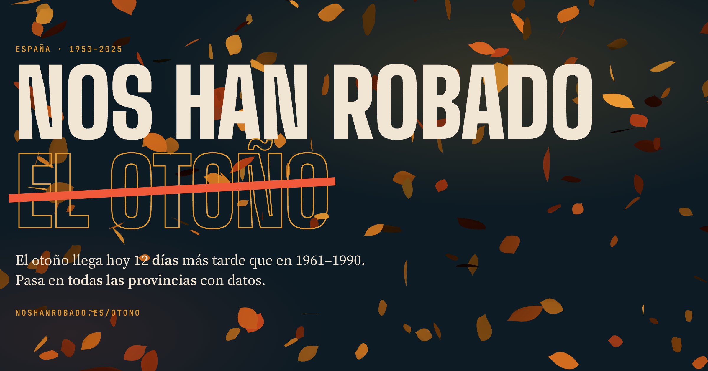

<p align="center">
  <a href="https://noshanrobado.es/otono/"></a>
</p>

<p align="center">
  <b><a href="https://noshanrobado.es/otono/">noshanrobado.es/otono</a></b>
</p>

## Por qué

Cada año parece que el otoño tarda más en llegar: octubres de manga corta, chaquetas que no salen del armario hasta noviembre. Es fácil decir «antes hacía más frío», pero quería comprobarlo con datos y no con recuerdos.

Esta web toma 76 otoños de termómetros (1950–2025), provincia a provincia, y responde a una pregunta sencilla: ¿cuántos días de otoño nos han robado? La respuesta es que el otoño llega hoy, de mediana, unos 12 días más tarde que en 1961–1990, y pasa en todas las provincias con datos. También explica quién es el culpable, y desmonta las otras sospechas populares, con enlaces a las fuentes oficiales.

Todo es reproducible: datos abiertos de ECA&D (que incluye AEMET), el código que los procesa y una web estática sin dependencias de build.

## Ver en local

```sh
cd public && python3 -m http.server 8765
# abrir http://localhost:8765
```

Hace falta servirla por HTTP (no vale abrir el archivo con doble clic) porque carga `data/*.json` con `fetch`.

## Publicar

`public/` es un sitio estático sin build. Three.js se carga desde jsDelivr (versión fijada 0.160.0). Está en Netlify (`netlify.toml` publica solo `public/`).

Cada enlace compartido (`?provincia=…&nacimiento=…`) se previsualiza con su propia denuncia: `netlify/edge-functions/og-meta.js` cambia la imagen de la vista previa y `netlify/functions/denuncia.mjs` la dibuja con el mismo código que la tarjeta de la web (`public/otono/js/card.js`). Netlify ejecuta la función en Linux, así que el despliegue instala también ese binario de `@napi-rs/canvas`:

```sh
npm install
npm run deploy   # instala el binario de Linux, publica y deja dibujadas las vistas previas de cada provincia
```

## Regenerar los datos

Los datos en bruto van en `data/`, que no se versiona (unos 800 MB). Se descargan así:

```sh
python3 -I scripts/fetch_ecad_es.py data/ecad
curl -o data/geo/nuts3_2021_03m.geojson https://gisco-services.ec.europa.eu/distribution/v2/nuts/geojson/NUTS_RG_03M_2021_4326_LEVL_3.geojson
python3 -I scripts/build_spain.py data/ecad data/geo/nuts3_2021_03m.geojson public/otono/data/spain.json
python3 -I scripts/build_geo.py data/geo/nuts3_2021_03m.geojson public/otono/data/provinces.json
```

Para comparar con Meteocat (Observatorio Fabra), el ZIP de series diarias desde 1950 va en `data/series-climatiques-baic-diaries-des-de-1950.zip`. Se descarga desde https://www.meteo.cat/wpweb/climatologia/dades-i-productes-climatics/series-climatiques-des-de-1950/.

- `build_data.py`: funciones de cálculo compartidas (también genera los indicadores de Meteocat del primer prototipo). Calcula, por estación y año, medias de septiembre a noviembre, días ≥25 °C, noches ≥15 °C y <10 °C, primera noche <10 °C, primer bloque de 3 noches <12 °C, último día ≥25 °C y tendencias con IC95 % corregido por autocorrelación.

## Estructura

La página sigue un solo hilo: eliges tu provincia (y tu año de nacimiento) en la portada o en la barra fija, y todo lo demás se adapta.

```
public/
  favicon.*, apple-touch-icon.png   iconos compartidos por todo el dominio
  otono/
    index.html          portada → Tu otoño → El frente del otoño (dos mapas, antes y hoy) → Muro → El culpable (con cómplices y otras sospechas) → Comparte → Metodología
    css/style.css
    js/spain.js         estado común (provincia, año), mapas del frente, lista, tarjeta para compartir, tabla (URL ?provincia=barcelona&nacimiento=1985)
    js/season.js        «Tu otoño»: franja que se desliza, gráfico año a año y tendencia, área desde que naciste
    js/wall.js          muro: días robados por provincia y año
    js/spain-data.js    carga de datos y tendencia (regresión local) en el navegador
    js/hero.js          hojas 3D de la portada
    js/card.js          tarjeta de la denuncia (la usan la web y la vista previa de los enlaces)
    js/data.js          utilidades de formato y color
    data/               spain.json, provinces.json
netlify/              vista previa de cada enlace (función, edge function y fuentes)
scripts/              generación reproducible de datos (shift.py calcula los días robados)
```

## Licencias de datos

- ECA&D: uso no comercial para investigación y educación, citando Klein Tank et al. (2002).
- Meteocat: series climáticas diarias desde 1950 (meteo.cat).
- Límites: © EuroGeographics (GISCO).
